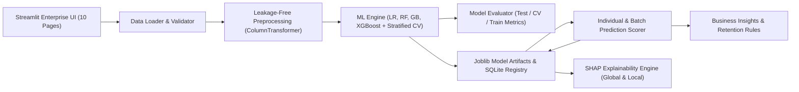
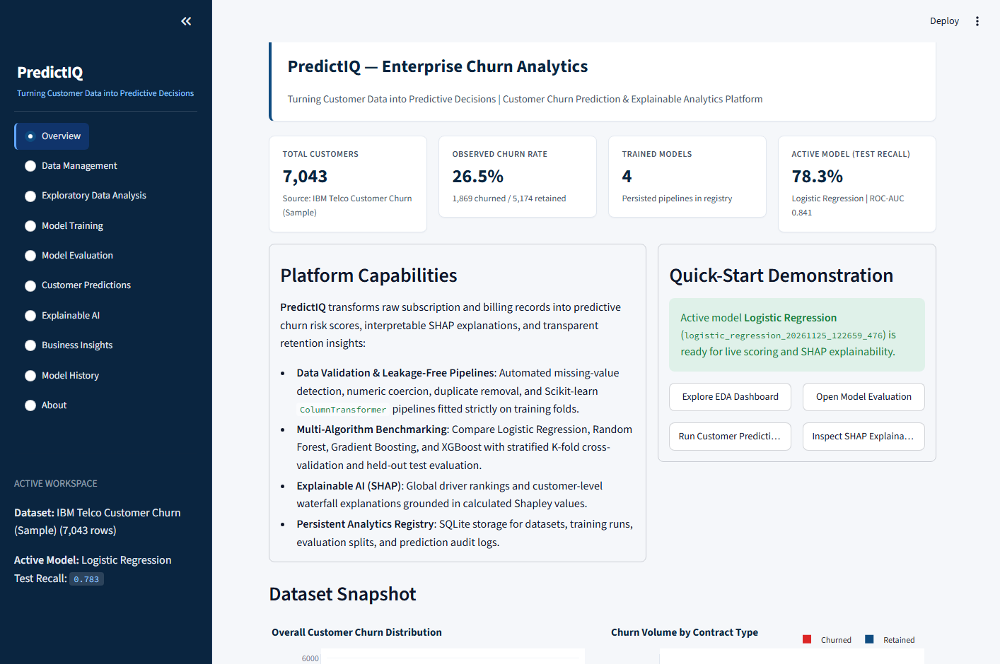
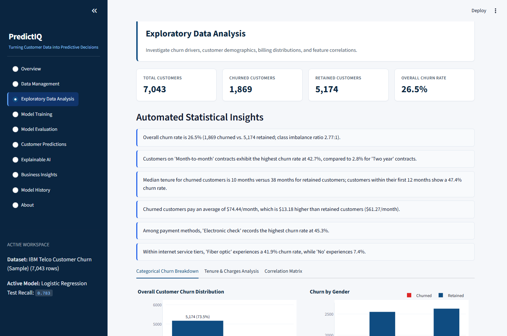
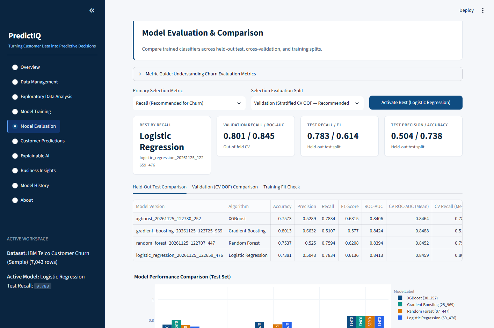
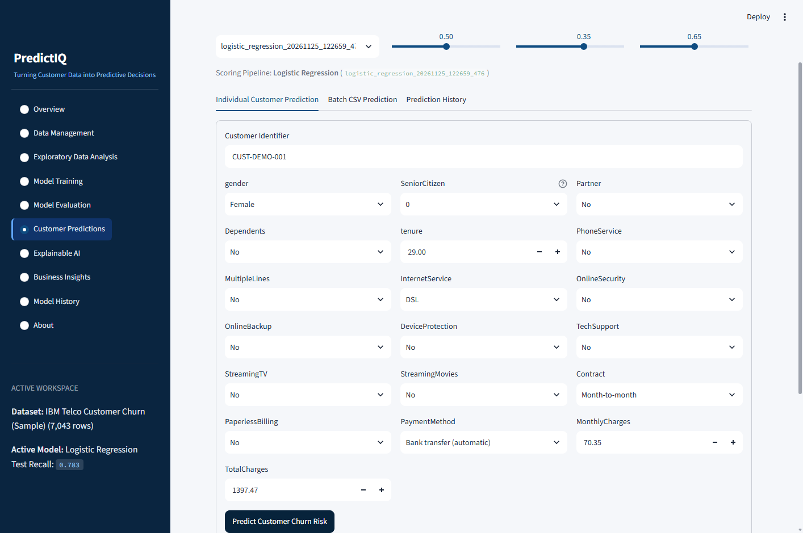
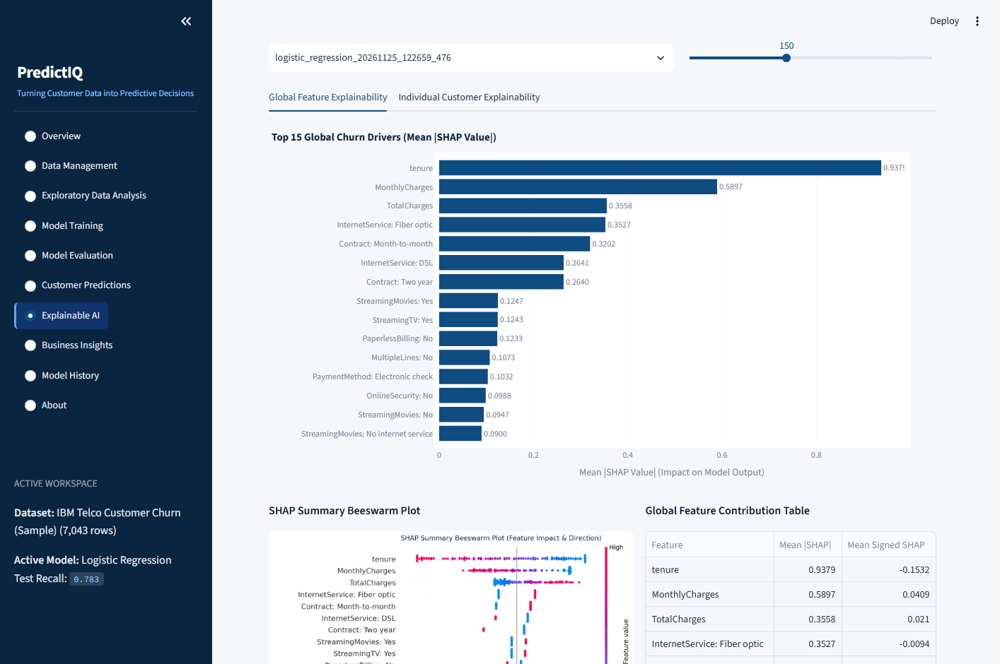
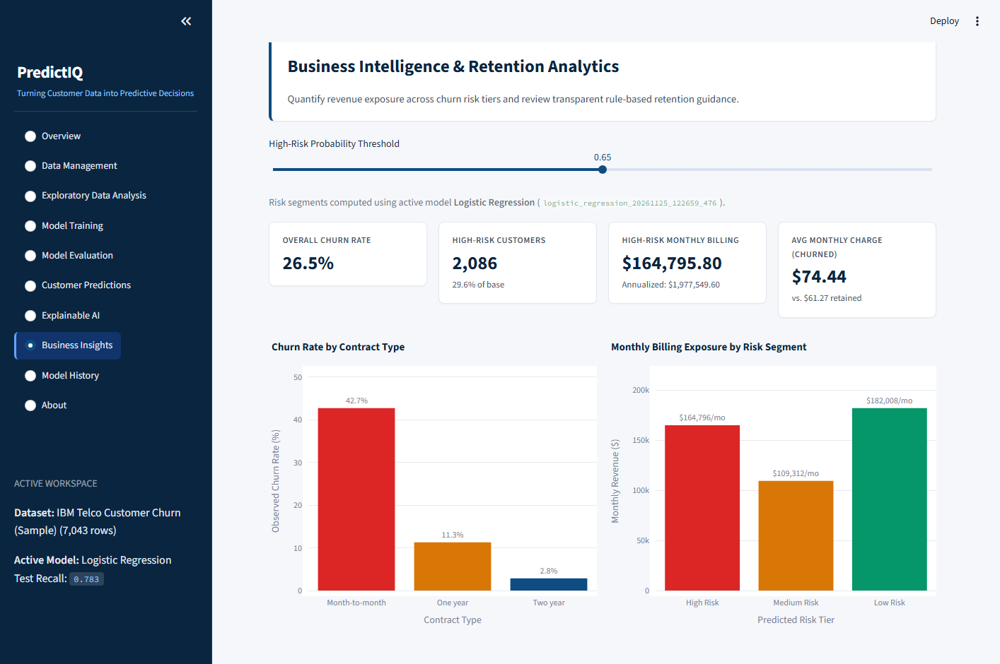

# PredictIQ — Customer Churn Prediction & Explainable Analytics Platform

**Tagline:** *Turning Customer Data into Predictive Decisions*

PredictIQ is a production-structured, end-to-end customer churn prediction, model benchmarking, and explainable AI analytics platform built with Python, Scikit-learn, SHAP, Plotly, SQLite, and Streamlit. Designed with an enterprise analytics aesthetic inspired by SAS Viya, PredictIQ transforms raw subscription and billing records into calibrated churn probabilities, interpretable Shapley explanations, and actionable retention intelligence.

---

## 1. Project Overview

Customer retention is one of the highest-leverage drivers of recurring-revenue profitability. PredictIQ provides an interactive, leakage-free machine learning workflow that covers the entire analytics lifecycle:

- Automated schema & data-quality validation
- Exploratory Data Analysis (EDA) with dynamically computed statistical insights
- Leakage-free Scikit-learn preprocessing pipelines & stratified cross-validation
- Multi-algorithm benchmarking (Logistic Regression, Random Forest, Gradient Boosting, XGBoost)
- Multi-split evaluation (Train, Stratified CV Out-of-Fold Validation, and Held-Out Test)
- Individual and batch CSV churn scoring with configurable risk thresholds
- Global & customer-level SHAP Explainable AI with value-grounded natural-language narratives
- Rule-based retention strategy recommendations and SQLite experiment tracking

---

## 2. Problem Statement

Subscription businesses face significant revenue erosion when customers discontinue their services. Identifying at-risk customers *before* cancellation requires more than descriptive historical reporting: teams need calibrated risk probabilities, transparency into **why** each customer is flagged, and rigorous evaluation focused on minimizing missed churners (False Negatives).

---

## 3. Objectives

1. **Identify At-Risk Customers**: Estimate individual churn probability and stratify accounts into `Low Risk`, `Medium Risk`, and `High Risk` tiers.
2. **Prevent Data Leakage**: Encapsulate all imputation, scaling, and encoding transformations inside Scikit-learn `Pipeline` objects fitted strictly on training folds.
3. **Prioritize Business-Aligned Metrics**: Emphasize **Recall**, **ROC-AUC**, and **PR-AUC** rather than relying solely on accuracy on imbalanced churn datasets.
4. **Deliver Transparent Explainability**: Explain both global model behavior and single-customer predictions using calculated SHAP values.
5. **Maintain Reproducibility & Persistence**: Persist trained pipelines (`joblib`), dataset metadata, model run histories, evaluation splits, and prediction logs in SQLite.

---

## 4. Features

- **10-Page Enterprise Navigation**: Overview, Data Management, Exploratory Data Analysis, Model Training, Model Evaluation, Customer Predictions, Explainable AI, Business Insights, Model History, and About.
- **Zero-Setup Quick Start**: Ships with the IBM Telco Customer Churn dataset (`7,043` records) ready on launch, plus custom CSV upload support.
- **Data Quality Validation**: Detects missing values, whitespace-corrupted numeric strings (e.g., blank `TotalCharges`), duplicate records, negative numeric anomalies, ID columns, and target class balance.
- **Interactive EDA**: 9+ Plotly visualizations and dynamically calculated statistical observations (never hardcoded).
- **Configurable ML Training**: Stratified train-test split, K-fold cross-validation, class weighting (`balanced` / `scale_pos_weight`), and per-algorithm hyperparameter controls.
- **Model Evaluation & Selection**: Classification report, confusion matrix heatmap, multi-model ROC & Precision-Recall curves, and best-model selection by configurable metric (`Recall`, `ROC-AUC`, `F1-Score`, `Precision`, or `Accuracy`).
- **Scoring & Audit Trail**: Single-customer prediction gauge, batch CSV scoring with downloadable CSV results, and SQLite prediction history.
- **Explainable AI (SHAP)**: Global Mean `|SHAP|` bar chart, SHAP summary beeswarm plot, individual customer waterfall plot, and value-grounded natural-language explanation.

---

## 5. Technology Stack

| Layer | Technologies |
| :--- | :--- |
| **Programming & Data** | Python 3.11+ (verified on 3.13.7), Pandas, NumPy |
| **Machine Learning** | Scikit-learn (`Pipeline`, `ColumnTransformer`, `LogisticRegression`, `RandomForestClassifier`, `GradientBoostingClassifier`), XGBoost |
| **Explainable AI** | SHAP (`LinearExplainer`, `TreeExplainer`, `Explainer`) |
| **Visualization** | Plotly, Matplotlib, Seaborn |
| **Frontend UI** | Streamlit (custom enterprise CSS theme inspired by SAS Viya) |
| **Persistence** | SQLite (`database/predictiq.db`), Joblib (`models/saved_models/*.joblib`) |
| **Testing** | Pytest, Selenium headless E2E verification |

---

## 6. System Architecture



### Repository Structure

```text
predictIQ/
├── app.py                        # Streamlit entry point & sidebar router
├── requirements.txt              # Python dependencies
├── README.md                     # Project documentation
├── .streamlit/config.toml        # Light enterprise theme & navigation config
├── assets/
│   ├── styles.css                # SAS Viya-inspired enterprise CSS
│   └── screenshots/              # Verified application screenshots
├── data/
│   └── telco_churn.csv           # IBM Telco Customer Churn sample dataset
├── database/
│   └── database.py               # SQLite schema & repository methods
├── models/
│   └── saved_models/             # Serialized joblib model pipeline bundles
├── pages/                        # 10 modular Streamlit page views
│   ├── overview.py
│   ├── data_management.py
│   ├── exploratory_analysis.py
│   ├── model_training.py
│   ├── model_evaluation.py
│   ├── customer_predictions.py
│   ├── explainable_ai.py
│   ├── business_insights.py
│   ├── model_history.py
│   └── about.py
├── src/                          # Core business logic & ML engine
│   ├── data_loader.py
│   ├── preprocessing.py
│   ├── eda.py
│   ├── model_training.py
│   ├── model_evaluation.py
│   ├── model_manager.py
│   ├── prediction.py
│   ├── explainability.py
│   └── business_insights.py
├── tests/                        # Automated Pytest suite
│   ├── test_validation.py
│   ├── test_preprocessing.py
│   ├── test_training.py
│   └── test_prediction.py
└── utils/
    ├── config.py
    ├── helpers.py
    └── validation.py
```

---

## 7. Machine Learning Methodology

1. **Structural Cleanup**: Identifier columns (`customerID`) are excluded from features, numeric-like string columns (`TotalCharges`) are coerced to numeric (`NaN` for blanks), and exact duplicates are removed prior to splitting.
2. **Stratified Train-Test Split**: Data is partitioned (default 80/20) with `stratify=y` and a fixed `random_state` so churn prevalence (~26.5%) matches across train and test sets.
3. **Stratified K-Fold Cross-Validation**: On the training split only, a `StratifiedKFold` loop computes out-of-fold validation predictions and fold-level mean/std metrics.
4. **Strict Separation of Splits**:
   - **Train**: Pipeline fitted on `X_train` to check model capacity vs. overfitting.
   - **Validation**: Out-of-fold predictions across `StratifiedKFold` splits of `X_train` — used for model comparison and best-model selection.
   - **Test**: Held-out `X_test` evaluated once after final fitting on `X_train` — never used for tuning or model selection.

---

## 8. Dataset Description and Source

- **Dataset**: IBM Sample Data Sets — *Telco Customer Churn* (`data/telco_churn.csv`)
- **Dimensions**: `7,043` customer records, `21` columns (`19` predictive attributes, `customerID`, and binary `Churn` target)
- **Target Distribution**: `5,174` Retained (`73.5%`), `1,869` Churned (`26.5%`)
- **Known Data Quality Nuance**: `11` rows with `tenure = 0` contain blank strings in `TotalCharges`, which PredictIQ automatically flags as invalid/coerced missing values and imputes inside the training pipeline.
- **Attribution**: Provided as part of IBM's publicly available Telco Customer Churn sample dataset (`IBM/telco-customer-churn-on-icp4d`).

---

## 9. Data Preprocessing Methodology

All statistical preprocessing is encapsulated inside a Scikit-learn `ColumnTransformer`:

- **Numerical Pipeline**: `SimpleImputer(strategy="median")` followed by `StandardScaler()`
- **Categorical Pipeline**: `SimpleImputer(strategy="most_frequent")` followed by `OneHotEncoder(handle_unknown="ignore", sparse_output=False)`

Because the `ColumnTransformer` is the first step of the `sklearn.pipeline.Pipeline`, medians, means, standard deviations, and category vocabularies are learned strictly on training folds and applied consistently at validation, test, and production inference time.

---

## 10. Algorithms Used & Selection Rationale

| Algorithm | Rationale for Selection |
| :--- | :--- |
| **Logistic Regression** | Interpretable, fast linear baseline estimating calibrated log-odds; supports `class_weight="balanced"` and exact `shap.LinearExplainer` attributions. |
| **Random Forest Classifier** | Bagged decision-tree ensemble capturing non-linear interactions and threshold effects; supports `class_weight="balanced"` and `shap.TreeExplainer`. |
| **Gradient Boosting Classifier** | Sequential residual-correcting tree ensemble providing strong probability ranking (`ROC-AUC`) on tabular customer data. |
| **XGBoost Classifier** | Regularized gradient-boosted trees with native `scale_pos_weight` imbalance handling and fast `shap.TreeExplainer` compatibility. |

---

## 11. Evaluation Metrics (Observed Benchmark Results)

Evaluated on the full IBM Telco Customer Churn dataset (`80/20` stratified split, `5-fold` CV, `random_state=42`, class weighting enabled):

| Algorithm | Val Recall (CV OOF) | Val ROC-AUC | Test Accuracy | Test Precision | Test Recall | Test F1-Score | Test ROC-AUC |
| :--- | :---: | :---: | :---: | :---: | :---: | :---: | :---: |
| **Logistic Regression** | **0.8013** | 0.8455 | 0.7381 | 0.5043 | **0.7834** | 0.6136 | 0.8413 |
| **XGBoost** | 0.7846 | 0.8460 | 0.7573 | 0.5289 | **0.7834** | **0.6315** | 0.8406 |
| **Random Forest** | 0.7579 | 0.8447 | 0.7537 | 0.5250 | 0.7594 | 0.6208 | 0.8394 |
| **Gradient Boosting** | 0.5191 | **0.8481** | **0.8013** | **0.6632** | 0.5107 | 0.5770 | **0.8424** |

> **Why Recall Matters**: Notice that unweighted Gradient Boosting achieves the highest Test Accuracy (`80.13%`) and ROC-AUC (`0.8424`), yet misses nearly half of actual churners (`51.07%` Recall). Because failing to detect a churning customer costs ongoing subscription revenue, PredictIQ highlights **Recall** and supports configurable classification thresholds and balanced weighting (`Logistic Regression` and `XGBoost` both reach `78.34%` Test Recall).

---

## 12. Explainable AI Implementation

PredictIQ integrates **SHAP** directly with the fitted preprocessing + classifier pipeline:

- **Explainer Selection**:
  - `Logistic Regression` -> `shap.LinearExplainer`
  - `Random Forest`, `Gradient Boosting`, `XGBoost` -> `shap.TreeExplainer` (positive churn class extracted uniformly)
  - Generic fallback -> `shap.Explainer`
- **Global Explanations**: Mean `|SHAP|` feature importance ranking bar chart + SHAP summary beeswarm plot. Across tree models on the Telco dataset, `Contract: Month-to-month` consistently emerges as a top global driver alongside `tenure`, `InternetService: Fiber optic`, and `MonthlyCharges`.
- **Individual Explanations**: Customer-level waterfall plot, positive/negative driver breakdown, and an automated natural-language narrative built directly from the customer's calculated SHAP contributions.

---

## 13. Installation Instructions

```bash
# 1. Clone or open the project directory
cd predictIQ

# 2. (Optional) Create and activate a virtual environment
python -m venv .venv
.venv\Scripts\activate      # Windows
# source .venv/bin/activate # macOS / Linux

# 3. Install dependencies
pip install -r requirements.txt
```

---

## 14. Execution Instructions

### Run the Streamlit Application

```bash
streamlit run app.py
```

The application opens at `http://localhost:8501` with the IBM Telco dataset pre-loaded.

### Run Automated Tests

```bash
pytest -v
```

---

## 15. Screenshots

| Overview Dashboard | Exploratory Data Analysis |
| :---: | :---: |
|  |  |

| Model Evaluation | Customer Predictions |
| :---: | :---: |
|  |  |

| Explainable AI (SHAP) | Business Insights |
| :---: | :---: |
|  |  |

---

## 16. Limitations, Class Imbalance, Bias & Generalization

- **Class Imbalance**: The Telco dataset has a `2.77:1` imbalance (`73.5%` retained vs. `26.5%` churned). While class weighting improves Recall, it trades off Precision (`~50%–53%`), meaning retention outreach budgets must account for false positives.
- **Cross-Sectional Snapshot**: The dataset lacks longitudinal time-series usage events (e.g., support ticket trends or monthly usage drops), limiting temporal early-warning signals.
- **Model Bias & Calibration**: Tree models with `scale_pos_weight` or balanced class weights shift predicted probabilities upward; threshold tuning and probability calibration (e.g., Platt scaling / isotonic regression) are recommended before automating high-cost incentives.
- **Generalization & Custom Datasets**: `OneHotEncoder(handle_unknown="ignore")` prevents crashes on unseen categories at inference time, though novel categories carry zero learned weight until retraining.
- **Non-Causal Recommendations**: Rule-based retention actions on the Business Insights page highlight high-risk billing/contract segments observed in the data; they do **not** claim experimentally validated churn reduction without controlled A/B testing.

---

## 17. Future Enhancements

- Probability calibration (`CalibratedClassifierCV`) for balanced vs. unweighted models
- Cost-sensitive threshold optimizer using customer lifetime value (CLV) vs. retention offer cost
- Automated drift monitoring (Population Stability Index) on uploaded scoring batches
- REST scoring endpoint (FastAPI) alongside the Streamlit analytics workbench
